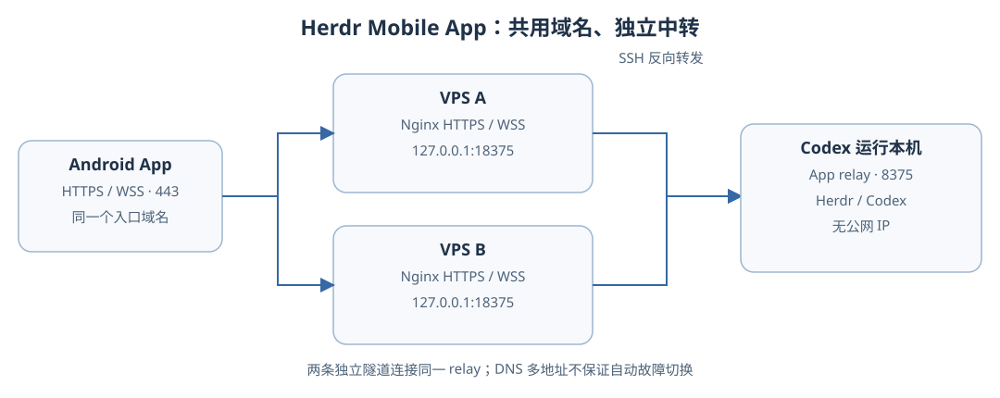
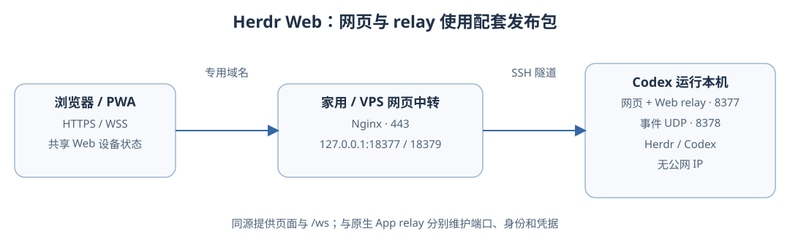

# Herdr Mobile 方案

Codex 运行的本机没有公网 IP，通过 SSH 反向转发接入中转服务器。家用和 VPS 网页入口共用一个 Web relay；原生 App 使用独立 relay。各入口可分别启停。

## 入口与组件

| 用途 | 家用中转网页 | VPS 中转网页 | Android App |
|---|---|---|---|
| 上游 | [0cv/herdr-mobile-relay](https://github.com/0cv/herdr-mobile-relay) | 同左 | [teasec4/herdr-mobile-app](https://github.com/teasec4/herdr-mobile-app) |
| 入口示例 | `https://herdr-web.example.com` | `https://herdr-relay.example.com` | `https://herdr-mobile.example.com` |
| 本机服务 | Web relay | 同左 | `herdrelay` |
| 本机端口 | TCP `8377`、事件 UDP `8378` | 同左 | TCP `8375` |
| 中转端口 | `127.0.0.1:18377` | 每台 VPS 的 `127.0.0.1:18379` | 每台 VPS 的 `127.0.0.1:18375` |
| 配对 | Web relay 设备授权、一次性邀请 | 共用 Web relay 的设备状态 | 共享 relay token |

本机服务仅监听 loopback。VPS 网页和 App 域名均可解析到两台 VPS，各模式分别转发到自己的本机 relay。DNS 多地址不等于自动故障切换，切换取决于客户端及 DNS 缓存。本机离线时远程入口无法控制会话。

App v0.4.0 的 `funnel` 模式忽略自定义端口，因此公网入口使用标准 **443**。网页版支持显式 HTTPS/WSS 端口。[App 地址构造](https://github.com/teasec4/herdr-mobile-app/blob/v0.4.0/client/lib/models/pair_config.dart)

## 本机部署





安装固定版本发布包并验证校验和。两个网页入口转发到同一个 Web relay；不能只部署 App 项目的 Flutter Web 骨架。所有 relay 使用原用户的 Herdr 路径、socket 和主目录。

| 位置 | 内容 |
|---|---|
| `/usr/local/libexec/herdr-mobile/` | App relay |
| `/usr/local/libexec/herdr-web/releases/<版本>/` | 网页完整发布包，`current` 指向所选版本 |
| `/usr/local/etc/herdr-mobile/`、`herdr-web/`、`herdr-relay/` | 专用 SSH 配置 |
| `/usr/local/var/log/herdr-mobile/`、`herdr-web/`、`herdr-relay/` | 日志 |
| `/Library/LaunchDaemons/` | 系统级 relay 与隧道启动配置 |
| `~/.config/herdr/herdrelay.token`、`herdrelay.id` | App 凭据及身份 |
| `~/.config/herdr-web/relay.env` | Web relay 环境、凭据和设备状态 |

App 设置 `HERDRELAY_MODE=lan`、`HERDRELAY_LISTEN=127.0.0.1:8375`；配对链接使用 `mode=funnel`，公网 TLS 在中转终止。

网页环境如下；另设置实际 `HERDR_BIN`、`HERDR_SOCKET_PATH`、`HERDR_RELEASE_ROOT`、`HERDR_WEB_ROOT`，生成 Web 专用的 32 字符 `HERDR_RELAY_TOKEN` 和稳定的 `HERDR_RELAY_INSTANCE_ID`：

```bash
HERDR_RELAY_HOST=127.0.0.1
HERDR_RELAY_PORT=8377
HERDR_RELAY_PLUGIN_PORT=8378
HERDR_ALLOWED_ORIGINS=https://herdr-web.example.com
HERDR_PHONE_APP_URL=https://herdr-web.example.com
HERDR_GATEWAY_URL=
HERDR_TRANSPORT_FORCE_RELAY=1
HERDR_REACHABILITY_PORT_MAPPING=0
HERDR_RELAY_REARM_BOOTSTRAP=0
```

`HERDR_PHONE_APP_URL` 指定通知默认打开的网页入口；另一网页入口仍可独立访问和配对。

两个网页入口使用各自的域名和中转站点，经 SSH 隧道接入同一 Web relay。通过 `HERDR_RELAY_ENV` 指定其私密环境文件，固定设备状态目录；启动器加载环境后执行 `herdr-mobile-relay serve`。网页与 `/ws` 均由配套 relay 提供，此路径不需要额外 gateway。

## SSH 与常驻管理

从既有连接复制主机、用户、端口和密钥参数，不复制其他 `RemoteForward`。每台中转使用独立 SSH 进程：

```sshconfig
Host herdr-relay
  HostName <中转地址>
  User <SSH用户>
  Port <SSH端口>
  IdentityFile <私钥绝对路径>
  IdentitiesOnly yes
  IdentityAgent none
  ControlMaster no
  ControlPath none
  BatchMode yes
  ConnectTimeout 10
  ServerAliveInterval 30
  ServerAliveCountMax 3
  ExitOnForwardFailure yes
```

```bash
# 网页中转；SSH 配置中的 Host 使用 herdr-web-relay
ssh -F /usr/local/etc/herdr-web/ssh.conf -NT \
  -R 127.0.0.1:18377:127.0.0.1:8377 herdr-web-relay

# App 每台 VPS 各一条，配置对应的 Host 别名
ssh -F /usr/local/etc/herdr-mobile/vps-ssh.conf -NT \
  -R 127.0.0.1:18375:127.0.0.1:8375 <App中转别名>

# VPS 网页每台各一条，使用另一份 SSH 配置和 Host 别名
ssh -F /usr/local/etc/herdr-relay/vps-ssh.conf -NT \
  -R 127.0.0.1:18379:127.0.0.1:8377 <网页中转别名>
```

将命令逐参数写入 plist 的 `ProgramArguments`，不加 `-f`。标签使用 `com.herdrelay.relay`、`local.herdr-web-relay`、`local.herdr-web-tunnel`、`local.herdr-relay-tunnel-<节点>`、`local.herdr-mobile-tunnel-<节点>`。

设置 `UserName` 为 Codex 运行用户，配置 `HOME`、`PATH`、`RunAtLoad`、`KeepAlive`、`ThrottleInterval=10`、`Umask=63` 和日志路径。plist 归管理员所有、权限 `0644`；私密目录 `0700`，凭据及日志文件 `0600`。

```bash
sudo plutil -lint /Library/LaunchDaemons/<标签>.plist
sudo launchctl bootstrap system /Library/LaunchDaemons/<标签>.plist
sudo launchctl print system/<标签>
sudo launchctl kickstart -k system/<标签>  # 按需重启
```

修改 plist 后先 `launchctl bootout system/<标签>`，再 `bootstrap`。迁移后卸载并归档旧服务，避免重复隧道。

原生 App 平时停用时，保留配置并对 `com.herdrelay.relay` 及两个 `local.herdr-mobile-tunnel-<节点>` 依次执行 `sudo launchctl disable system/<标签>`、`sudo launchctl bootout system/<标签>`。恢复时依次执行 `enable` 和 `bootstrap`；Web relay 及两个网页入口可继续运行。

## 独立站点配置

只操作 Herdr 独立配置，主站及其他子域名保持原样。域名与证书由部署者准备；证书未就绪时先验收内部转发，再加载 TLS 配置。

### 网页：Nginx 终止 TLS

保存为实际 include 目录中的 `herdr-web.conf`：

```nginx
map $http_upgrade $herdr_web_connection_upgrade {
    default upgrade;
    '' close;
}
server {
    listen 443 ssl;
    listen [::]:443 ssl;
    server_name herdr-web.example.com;
    ssl_certificate /path/to/fullchain.pem;
    ssl_certificate_key /path/to/privkey.pem;
    client_max_body_size 32m;
    location / {
        proxy_pass http://127.0.0.1:18377;
        proxy_http_version 1.1;
        proxy_set_header Host $http_host;
        proxy_set_header Authorization $http_authorization;
        proxy_set_header Upgrade $http_upgrade;
        proxy_set_header Connection $herdr_web_connection_upgrade;
        proxy_set_header X-Forwarded-For $remote_addr;
        proxy_set_header X-Forwarded-Proto $scheme;
        proxy_buffering off;
        proxy_read_timeout 300s;
        proxy_send_timeout 300s;
    }
}
```

保留 Host 中的端口。带密钥的浏览器连接由加密握手授权；`HERDR_ALLOWED_ORIGINS` 仅限制无令牌的本地开发连接。网页首页可能重定向到带版本的 HTML，验收时检查最终页面及资源。[上游安全说明](https://github.com/0cv/herdr-mobile-relay/blob/main/docs/security.md)

VPS 网页在每台中转服务器另建 `herdr-relay.conf`，沿用上述 Nginx 网页配置，将 `server_name` 改为 `herdr-relay.example.com`、`proxy_pass` 改为 `http://127.0.0.1:18379`，并使用独立的 `map` 变量名。它有自己的域名和证书覆盖范围，不复用家用网页或 App 的站点配置。

### App：Nginx 终止 TLS

在每台中转服务器的 Nginx include 目录中增加独立的 `herdr-mobile.conf`：

```nginx
map $http_upgrade $herdr_mobile_connection_upgrade {
    default upgrade;
    '' close;
}
server {
    listen 443 ssl;
    listen [::]:443 ssl;
    server_name herdr-mobile.example.com;
    ssl_certificate /path/to/fullchain.pem;
    ssl_certificate_key /path/to/privkey.pem;
    client_max_body_size 32m;
    location / {
        proxy_pass http://127.0.0.1:18375;
        proxy_http_version 1.1;
        proxy_set_header Host $http_host;
        proxy_set_header Authorization $http_authorization;
        proxy_set_header Upgrade $http_upgrade;
        proxy_set_header Connection $herdr_mobile_connection_upgrade;
        proxy_set_header X-Forwarded-For $remote_addr;
        proxy_set_header X-Forwarded-Proto $scheme;
        proxy_buffering off;
        proxy_read_timeout 300s;
        proxy_send_timeout 300s;
    }
}
```

将示例域名和证书路径替换为实际值，证书须覆盖对应入口域名。两个站点可以共享 443，由 Nginx 按域名分流；部署到多台中转时，每台分别配置证书和上游。

```bash
sudo nginx -t && sudo systemctl reload nginx
```

## 配对与验收

[配对脚本](../scripts/herdr-pair.sh) 使用 Bash 和 `jq`，从私密配置 `~/.config/herdr-mobile/endpoints.json` 读取入口：

```json
{
  "app": {"host": "herdr-mobile.example.com", "port": 443},
  "web": {"origin": "https://herdr-web.example.com"},
  "web_vps": {"origin": "https://herdr-relay.example.com"}
}
```

```bash
bash scripts/herdr-pair.sh app
bash scripts/herdr-pair.sh web
bash scripts/herdr-pair.sh relay
```

脚本依赖上述系统目录布局，直接在终端显示链接和二维码，不保存文件。网页邀请一次有效、有效期 10 分钟，每添加一个新浏览器重新运行；App 保留原 token 和身份。浏览器首次打开邀请后配对，之后直接打开站点，也可添加到手机主屏幕。

验收顺序：各本机 relay → 每台中转上游 → `nginx -t` → 公网证书、鉴权及 WSS → 浏览器配对、会话查看、输入和审批。App 启用时另验 `/healthz`。

网页支持 Web Push，App 使用本地通知和后台检查；授权及锁屏到达需在手机上单独验收。系统级部署通过管理员更新完整发布包并重启服务，不使用网页更新器切换版本。升级网页时保留设备状态，升级 App relay 时保留身份和 token。

如需出站 WSS，可改用上游的 [自建 gateway](https://github.com/0cv/herdr-mobile-relay/blob/main/docs/gateway-self-hosting.md)；它是网页协议的可选传输，不与 App relay 通用。私密凭据、实际域名、日志和临时排查状态不写入仓库。
